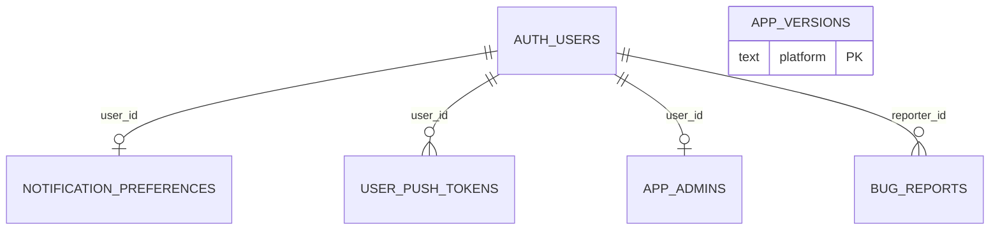
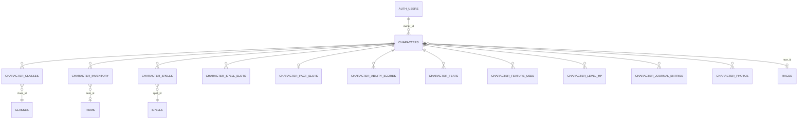
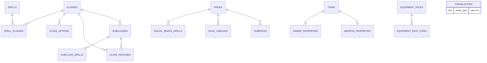
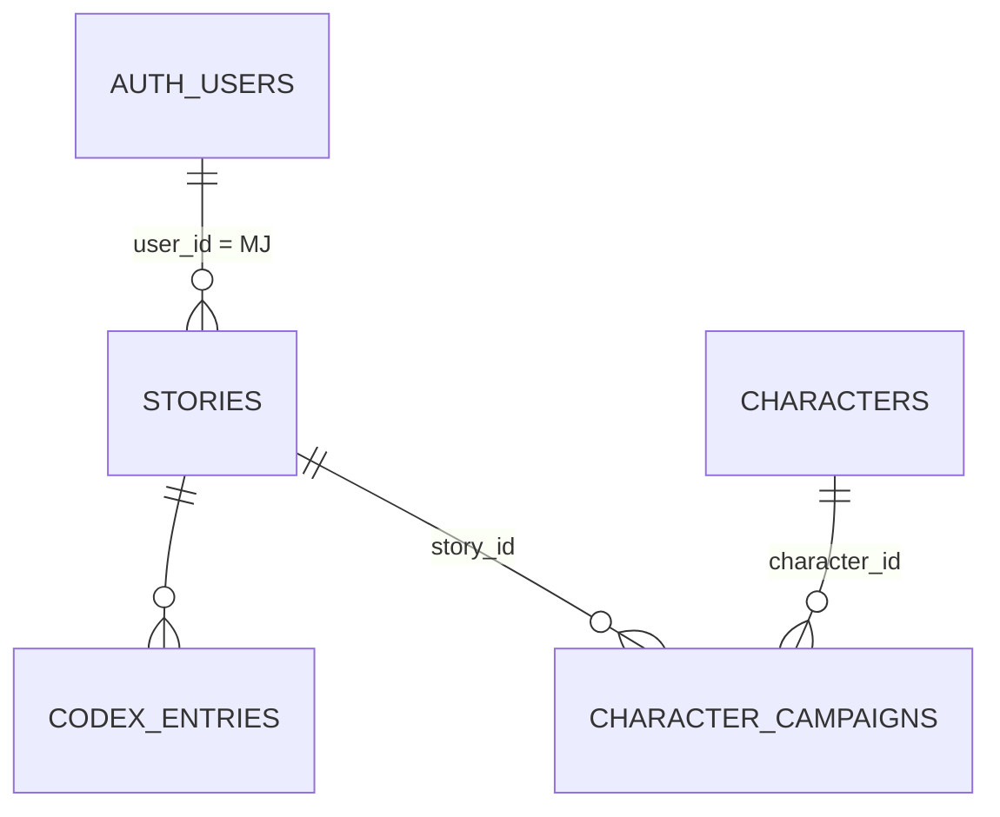
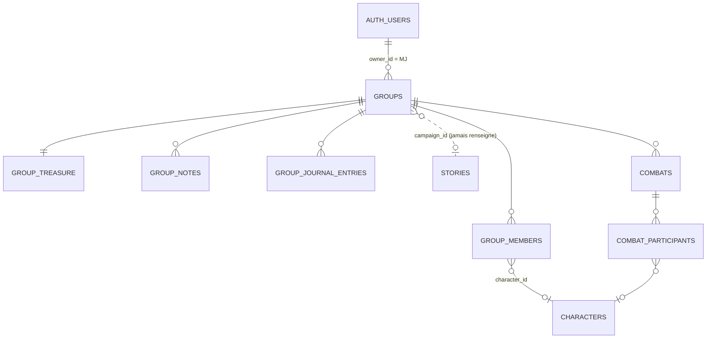
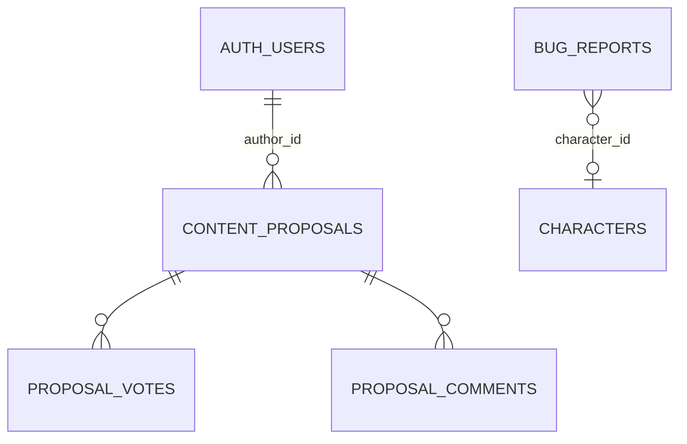

# 01 - Cartographie de la base Nexus JDR (lecture seule)

Date : 14/11/2026. Etape 1 de la refonte « API partagee ». Aucune modification de depot, aucune connexion a une base distante.

## 0. Methode et fiabilite

Legende de fiabilite : **[C]** certain (lu dans une migration ou le code), **[D]** deduit, **[I]** incertain (depend de la production reelle, non visible).

- **Rejeu reel des 160 migrations** du depot web (`H:/Projets/Labo/markdown-editor/supabase/migrations/`, derniere : `20261114091000_group_combat_rpcs.sql`) dans un **Postgres 17.2 jetable** (instance locale sur le port 54999, repertoire de donnees dans le dossier temporaire, hors des depots), avec des stubs minimaux des schemas Supabase (`auth`, `storage`, `vault`, `cron`, `net`, roles `anon/authenticated/service_role`). Chaque fichier a ete rejoue dans sa propre transaction. Resultat : **toutes les migrations passent**, sauf 2 erreurs attendues : `create extension pg_net` / `pg_cron` (extensions absentes de mon Postgres, remplacees par des stubs `net.http_post` / `cron.schedule`). Le schema ci-dessous est donc **[C] pour ce que disent les migrations**, pas pour l'etat reel de la production (voir section 11 et `04-questions.md`, requetes de controle).
- Annexes generees depuis ce rejeu (dans `annexes/`) : `schema_public_rejoue.sql` (pg_dump --schema-only, 9 336 lignes), `fonctions.txt`, `contraintes.txt`, `index.txt`, `policies_hors_reference.txt`, `stubs_supabase_local.sql` (stubs pour rejouer). Les « grants » de table du rejeu sont pollues par mes `ALTER DEFAULT PRIVILEGES` de stub (qui imitent Supabase) : ne pas s'y fier pour `anon` (voir S06).
- L'instance temporaire est arretee en fin de mission. Rien n'a ete laisse dans les depots.

## 1. Chiffres cles

| Objet | Nombre | Source |
|---|---|---|
| Tables `public` | **64** (RLS activee sur les 64) | rejeu [C] |
| Colonnes | 442 | rejeu [C] |
| Vues | 1 (`group_character_status_overview`, `security_invoker=true`) | [C] |
| Fonctions `public` | **40** (37 `SECURITY DEFINER`, 3 invoker) + 3 dans `private` | [C] |
| Triggers | 9 | [C] |
| Policies RLS | **278** (dont 44 avec `auth.uid()` nu, 81 `is_admin()`, 77 `owns_character()`) | [C] |
| Index (dont PK et uniques) | 97 | [C] |
| FK | 98 ; CHECK 76 ; contraintes UNIQUE 11 (+ index uniques partiels) | [C] |
| Publications Realtime | `supabase_realtime` : `characters`, `group_members`, `combats`, `combat_participants` | [C] |
| Buckets Storage | 5 : `story-covers`, `story-content-images`, `character-portraits`, `character-gallery-photos` (publics en lecture), `bug-report-screenshots` (prive) | [C] |
| Edge functions | 11 (+ `_shared`) | [C] |
| Tests SQL | 14 fichiers pgTAP, 4 284 lignes (dont 3 deja en echec connus, dette D60) | [C] |
| Seeds (lignes apres rejeu) | translations 7 467 ; spell_classes 1 392 ; class_features 1 030 ; spells 514 ; items 454 ; creatures 331 ; subclass_spells 320 ; subclasses 121 ; feats 116 ; class_options 97 ; backgrounds 71 ; autres < 70 | rejeu [C] |
| Donnees utilisateur | 0 ligne (seeds seulement) ; volumetrie reelle **[I]** | requetes de controle |
| Tables avec `comment on` | 10 / 64 ; colonnes commentees : 42 | [C] |
| Tables avec `updated_at` | 7 / 64 | [C] |

Usage (voir matrice section 9) : sur 64 tables, **~52 sont utilisees par l'app mobile**, **6 par l'app web** (`stories`, `codex_entries`, `character_campaigns`, `characters` en lecture, `character_classes` en lecture, `translations` en lecture), **5 par personne cote client** (`creatures`, `equipment_pack_items`, `content_proposals`, `proposal_votes`, `proposal_comments`) + `app_admins` (RLS seulement). L'app web **n'utilise ni Realtime, ni RPC, ni edge function, ni groupes, ni combat**.

## 2. Tables

Reperes : PK = cle primaire ; (n) = nombre de lignes de seed. `edition/source` = colonne d'edition 2014/2024.

### 2.1 Identite et administration

| Table | Colonnes cles | Contraintes notables | RLS (qui peut quoi) | Usage |
|---|---|---|---|---|
| `auth.users` (Supabase) | id, email, `raw_user_meta_data.full_name` | - | - | les deux |
| `app_admins` | user_id PK -> auth.users cascade | - | `using(false)` pour tous : aucun acces client ; lue par `is_admin()` | personne (client) |
| `app_versions` (2) | platform PK, min_supported_version, latest_version, store_url, updated_at | 3 CHECK | lecture anon+auth ; ecriture admin | mobile `app_version_repository.dart` |
| `notification_preferences` | user_id PK, push_* bool, email_digest_enabled, last_*_sent_at, updated_at | - | proprietaire select/insert/update | mobile |
| `user_push_tokens` | token PK, user_id, platform, updated_at | CHECK platform ; idx `user_id` | proprietaire CRUD ; ecritures reelles via RPC `claim_push_token` | mobile |
| `bug_reports` | id, reporter_id, title, description, severity, status, github_issue_*, screenshot_path, character_id | CHECK severity/status/chemin screenshot ; aucune policy UPDATE | rapporteur insert+select | mobile (via edge `report-bug`) |

### 2.2 Personnages (domaine « proprietaire ») - 21 tables

`characters` (46 colonnes, 6 FK, 2 CHECK) : id uuid, owner_id, name, race_id, subrace_id, lineage_id, background_id, alignment_id, race/background_custom_text, xp, max_hp, current_hp, temporary_hp, 14 colonnes d'apparence/RP en text, portrait_url, 5 colonnes `currency_*`, last_long_rest_at, is_dead, is_archived, inspiration, share_token (unique), `edition` text CHECK `2014|2024`, armor_class_bonus, `conditions jsonb`(array), created_at, **updated_at (jamais mis a jour, voir D-diag N04)**.

| Table | PK | Cle etrangere vers personnage | Particularites |
|---|---|---|---|
| `characters` | id | owner_id -> auth.users cascade | share_token unique ; pas d'index sur `owner_id` |
| `character_classes` | id uuid | character_id cascade | `level`, `is_primary`, `hit_dice_spent` (CHECK <= level) ; **aucune unicite (character_id, class_id)** |
| `character_ability_scores` | (character_id, ability_id) | cascade | |
| `character_ability_increases` | id | cascade | |
| `character_skill_proficiencies` | (character_id, skill_id) | cascade | |
| `character_tool_proficiencies` | id | cascade | |
| `character_languages` | (character_id, language_id) | cascade | |
| `character_feats` | (character_id, feat_id) | cascade | |
| `character_feature_uses` | (character_id, class_feature_id) | cascade | compteurs d'usage |
| `character_class_options` | id | cascade | choix de classe |
| `character_invocations` | (character_id, invocation_id) | cascade | |
| `character_race_choices` | id | cascade | |
| `character_level_hp` | id | cascade | PV par niveau, CHECK methode |
| `character_pact_slots` | character_id | cascade | magie de pacte |
| `character_pact_weapons` | character_id | cascade | item FK RESTRICT |
| `character_spell_slots` | (character_id, slot_level) | cascade | CHECK 1..9 |
| `character_spells` | id | cascade | statut `connu|prepare|inne` (CHECK), 2 index uniques partiels (inne / ordinaire), `innate_uses_spent`, `is_favorite`, `source_class_id` |
| `character_inventory` | id | cascade | 21 colonnes, 14 CHECK (objet perso `custom_*`), `equipped`, `is_attuned`, `weapon_slot` |
| `character_journal_entries` | id | cascade | journal prive |
| `character_photos` | id | cascade | galerie |
| `character_campaigns` | id, UNIQUE(character_id, story_id) | character_id + story_id cascade | **lien personnage <-> histoire** (`role` joueur/pnj) ; pas d'index sur `story_id` |

Index sur les tables enfants : **les tables a PK substituee `id` (inventory, classes, journal, photos, level_hp, race_choices, tool_proficiencies, class_options, ability_increases) n'ont AUCUN index sur `character_id`** ; les tables a PK composite en commencant par `character_id` sont couvertes. Voir P01.

### 2.3 Histoires (domaine MJ de l'app web)

| Table | Colonnes | Contraintes | RLS | Usage |
|---|---|---|---|---|
| `stories` | id, user_id (= MJ), title, cover_image_path, content text, published, invite_code (unique), invite_code_enabled, created_at, updated_at | unique invite_code | proprietaire CRUD (`to public`) ; **joueur rattache : SELECT ligne entiere** (`character_owner_can_read_joined_story`) | web (CRUD), mobile (embed titre/couverture) |
| `codex_entries` | id, story_id, user_id, category (CHECK 5 valeurs), name, summary, content, attributes jsonb | UNIQUE(story_id, name) ; pas d'index user_id | proprietaire CRUD (`to public`) | web uniquement |

### 2.4 Groupes (domaine mobile)

| Table | Colonnes | Contraintes | RLS | Usage |
|---|---|---|---|---|
| `groups` | id, name, owner_id (= MJ si `is_game_master`), invite_code (unique), **campaign_id -> stories (jamais renseigne)** | | membre select ; proprietaire select/update/delete ; pas d'INSERT client (edge `create-group`) | mobile |
| `group_members` | id, group_id, user_id, character_id (nullable), role (`owner|membre`), is_game_master, joined_at | UNIQUE(group_id,user_id) ; UNIQUE partiel (group_id,character_id) ; UNIQUE partiel un seul MJ sans personnage par groupe | membre select ; delete par soi ou par le proprietaire ; INSERT/UPDATE par edge functions (service_role) | mobile ; Realtime |
| `group_treasure` | group_id PK, currency_gp..cp, items jsonb | **aucun CHECK >= 0** | membre select **et update (toutes colonnes)** | mobile |
| `group_notes` | (group_id, user_id) PK, character_id, body, updated_at | | auteur CRUD | mobile |
| `group_journal_entries` | id, group_id, user_id, title, body | pas d'index group_id | auteur CRUD | mobile |
| vue `group_character_status_overview` | group_id, dead_count, low_hp_count | `security_invoker=true` | herite de characters/group_members | mobile |

### 2.5 Combat (PR web #47, appliquee)

| Table | Colonnes | Contraintes | RLS | Usage |
|---|---|---|---|---|
| `combats` | id, group_id, status `active|ended`, round >= 1, current_participant_id, started_by, created_at, ended_at | UNIQUE partiel un seul actif par groupe ; CHECK ended_at coherent ; FK composite `(current_participant_id, id)` | select membre ou proprietaire ; **ecriture : aucun GRANT client** (RPC uniquement) | mobile ; Realtime |
| `combat_participants` | id, combat_id, group_id (denormalise pour filtre Realtime), character_id, user_id, name (1..80), kind `pc|npc`, initiative -20..60, sort_order, status `active|removed|waiting` | UNIQUE(combat_id, character_id) ; UNIQUE partiel un PJ vivant par user ; CHECK forme pc/npc ; FK composite (combat_id, group_id) | idem | mobile ; Realtime |

### 2.6 Notifications et signalements

Notifications : `notification_preferences`, `user_push_tokens`, `app_versions` (trigger `notify_new_app_version`), trigger `notify_character_campaign_access_revoked`, schema `private` (`get_service_role_key`, `get_functions_base_url`, `invoke_edge_function` -> `net.http_post` via Vault), 2 jobs cron (`send-rest-reminders-daily` 10h, `send-weekly-digest-weekly` lundi 9h). Signalements : `bug_reports` + bucket `bug-report-screenshots`. Contributions de contenu : `content_proposals`, `proposal_votes`, `proposal_comments` (3 triggers) - aucun client ne les appelle.

### 2.7 Reference D&D (27 tables, lecture publique, ecriture `is_admin()`)

| Table | Lignes | Edition/source | Remarque |
|---|---|---|---|
| `translations` | 7 467 (fr 5 652 ; en 1 815) | - | EAV `(entity_type text, entity_id text, field_name, locale)` unique ; **aucune FK** vers l'entite ; 22 `entity_type` |
| `spells` | 514 | `source` texte libre FR (« Manuel des Joueurs », « Guide de Xanathar », « Manuel des Joueurs (2024) »...) ; **pas de colonne edition** | duration_kind/value/unit structures |
| `spell_classes` | 1 392 | - | PK (spell_id, class_id) ; pas d'index `class_id` |
| `subclass_spells` | 320 | - | |
| `items` | 454 | `source` texte (« Guide du maitre (2024) / SRD 5.2 », ...) | 250 + 103 en 2024, 95 en 2014 ; `armor_properties` (27), `weapon_properties` (45) |
| `creatures` | 331 | `source` unique = « SRD 5.2 (Manuel des Monstres 2024) » | **aucun client** |
| `classes` | 13 | `source` | |
| `subclasses` | 121 | pas de source | |
| `class_features` | 1 030 | `edition` **NULL pour toutes** | |
| `class_options` | 97 | `source` + `edition` (edition vide) | |
| `feats` | 116 | `source` code court + `edition` renseignee (`2014/2024`) | seule table propre sur l'edition |
| `races`, `subraces`, `race_lineages`, `racial_innate_spells` | 36 / 18 / 43 / 36 | `source` texte (races) ; `source_book` (lineages) | |
| `backgrounds` | 71 | **aucune source/edition** | `is_incomplete` |
| `invocations` | 54 | - | |
| `equipment_packs` (7), `equipment_pack_items` (66) | | `edition` sur les items | |
| `abilities` (6, id text ; colonne nommee `order`), `alignments` (9), `skills` (18), `tools` (36), `languages` (16), `weapon_properties`, `armor_properties` | | | |

## 3. Vues

| Vue | Definition | Droits | Usage |
|---|---|---|---|
| `group_character_status_overview` | count(is_dead), count(PV <= 25%) par `group_id` | `security_invoker=true`, `grant select to authenticated` | mobile `group_repository.dart` |

## 4. Fonctions et RPC (signature, mode, appelants)

Toutes celles marquees DEFINER ont un `set search_path` ; **24 sur 37 n'incluent pas `pg_temp`** (voir S09). ACL lue sur le rejeu (les `=X` = PUBLIC).

| Fonction | Mode | Execute | Appelant | Role |
|---|---|---|---|---|
| `owns_character(uuid)` | definer, stable | PUBLIC | RLS (77 policies) | proprietaire du personnage |
| `is_group_member(uuid)` | definer, stable | PUBLIC | RLS (groups, group_members, treasure, notes, journal) | |
| `is_group_owner(uuid)` | definer, stable | auth | RLS combat | |
| `group_has_gm(uuid)` | definer, stable | service_role | RPC combat | |
| `group_member_can_read_character(uuid)` | definer, stable | PUBLIC | RLS (5 policies : characters + 4 tables) | lecture croisee equipiers |
| `story_owner_can_read_character(uuid)` | definer, stable | PUBLIC | RLS (17 policies) | lecture MJ d'histoire |
| `character_owner_can_read_joined_story(uuid)` | definer, stable | PUBLIC | RLS stories | |
| `is_admin()` | definer, stable | PUBLIC | RLS (81 policies) | |
| `get_shared_character(text)` | definer | **anon+auth** | mobile + lien public | fiche en lecture seule par jeton |
| `get_group_member_character(uuid,uuid)` | definer | anon+auth (verifie `auth.uid()`) | mobile | fiche d'un equipier |
| `build_character_sheet_json(uuid)` | definer | service_role seul | interne | corps commun des 2 RPC ci-dessus (**base naturelle d'une ressource « fiche »**) |
| `regenerate_character_share_token(uuid)` | **invoker** | auth | mobile | jeton `gen_random_uuid()::text` |
| `claim_group_treasure_currency(uuid,uuid,text,int)` | **invoker**, EXECUTE PUBLIC | PUBLIC | mobile | reparti le tresor ; s'appuie sur la RLS |
| `claim_push_token(text,text)` / `release_push_token(text)` | definer | PUBLIC/anon+auth | mobile | |
| `create_character(...36 parametres)` | definer | auth | **aucun appelant** (D05, branchement mobile a faire) | creation transactionnelle |
| `apply_rest(uuid,text,text,int,int)` | definer | auth | **aucun appelant** | repos transactionnel |
| `apply_level_up(...11 params)` | definer | auth | **aucun appelant** | montee de niveau transactionnelle |
| `start_combat`, `end_combat`, `set_my_initiative`, `set_participant_initiative`, `add_npc_participants`, `remove_participant`, `reorder_participant` | definer | auth (anon revoque) | mobile `combat_repository.dart` | **modele a suivre** : codes d'erreur stables (`message` + SQLSTATE), `auth.uid()` verifie, verrou `FOR UPDATE` |
| `combat_lock_for_gm`, `combat_participant_combat_id` | definer | internes (revoke) | RPC combat | |
| `on_group_created` (trigger) | definer | | cree `group_treasure` | |
| `on_group_member_left_combat`, `on_combat_participant_deleted` | definer, triggers | revoke | | |
| `notify_character_campaign_access_revoked`, `notify_new_app_version` | definer triggers | | push | |
| `trg_content_proposals_review`, `trg_refresh_proposal_counts`, `refresh_proposal_counts(uuid)` | | `refresh_proposal_counts` **EXECUTE anon+auth** | triggers | |
| `get_translation(text,text,text)` | definer | service_role | interne | |
| colonnes calculees : `stories_gm_display_name(stories)`, `group_members_display_name(group_members)`, `content_proposals_author_name`, `proposal_comments_author_name` | definer, stable | PUBLIC | web/mobile (embed) | lisent `auth.users.raw_user_meta_data->>'full_name'` |

## 5. Triggers (9)

`character_campaigns_notify_access_revoked` (AFTER DELETE) ; `app_versions_notify_new_version` ; `groups_after_insert` (cree le tresor) ; `group_members_leave_combat_update/delete` ; `proposal_comments_refresh_counts`, `proposal_votes_refresh_counts` ; `content_proposals_review` ; `combat_participants_before_delete`. **Aucun trigger `updated_at`, aucun trigger d'audit, aucun trigger de version.**

## 6. Politiques RLS : synthese par table

Schemas de droits **[C]** :

- **Personnage (21 tables enfants)** : proprietaire = CRUD via `owns_character(character_id)` ; **MJ d'histoire** (`story_owner_can_read_character`) = SELECT sur 16 tables (pas journal, photos, race_choices) ; **membre de groupe** (`group_member_can_read_character`) = SELECT sur `characters`, `character_classes`, `ability_scores`, `class_options`, `inventory`. **Aucun droit d'ecriture pour un tiers, MJ compris.**
- `characters` : 3 SELECT (proprietaire, membre de groupe, MJ d'histoire), INSERT/UPDATE/DELETE proprietaire (aucune restriction de colonnes).
- `stories` : proprietaire CRUD ; joueur rattache SELECT. `codex_entries` : proprietaire CRUD.
- `character_campaigns` : proprietaire du personnage select/delete ; proprietaire de l'histoire select/delete ; **aucun INSERT client** (edge `join-story`).
- `groups` : membre select, proprietaire select/update/delete. `group_members` : membre select ; delete soi-meme / par le proprietaire. `group_treasure` : membre select + update. `group_notes`, `group_journal_entries` : auteur uniquement (journal de groupe : **chacun voit seulement le sien**).
- `combats`, `combat_participants` : select membre ou proprietaire ; aucune ecriture directe.
- Reference : lecture `anon`+`authenticated` ; ecriture `is_admin()` (3 policies par table).
- `content_proposals` : lecture anon+auth ; insert auth borne ; update admin. `proposal_votes` / `comments` : voir migration.
- Storage : `story-covers`, `story-content-images`, `character-portraits`, `character-gallery-photos` : lecture publique, ecriture dans `{uid}/...`.

## 7. Publications Realtime et Storage

| Element | Etat | Source |
|---|---|---|
| `supabase_realtime` | `characters` (20261107090000), `group_members` (20261108090000), `combats`, `combat_participants` (20261114090000) | [C] |
| REPLICA IDENTITY | **DEFAULT partout** (aucune migration ne la modifie) -> les DELETE ne portent que la PK | [C] |
| Abonnements mobile | `group_repository.dart:917` : `characters` UPDATE filtre `id in (...)`, `group_members` INSERT filtre `group_id` ; `combat_repository.dart:241` : `combats` + `combat_participants` filtre `group_id`, evenement `all` ; le callback fait un **re-fetch complet** | [C] |
| Abonnements web | **aucun** (TODO.md l.50 : « Synchronisation temps reel : pour l'instant la vue se recharge manuellement ») | [C] |
| Broadcast / Presence | non utilises | [C] |

## 8. Edge functions (11)

| Fonction | Role | Tables touchees (service_role) | Appelee par |
|---|---|---|---|
| `create-group` | cree groupe + membre MJ/joueur | characters, groups, group_members | mobile |
| `join-group` | rejoint par code | characters, group_members | mobile |
| `preview-group-invite` | apercu du code | group_members | mobile |
| `set-group-character` | change le personnage d'un membre | characters, group_members | mobile |
| `join-story` | rattache un personnage a une histoire (code d'invitation) | characters, character_campaigns | mobile |
| `preview-story-invite` | apercu histoire | stories | mobile |
| `delete-account` | supprime compte + objets Storage | auth.admin, storage | mobile |
| `report-bug` | cree issue GitHub + `bug_reports` | bug_reports, storage | mobile |
| `send-push-notification` | FCM | user_push_tokens | trigger/cron |
| `send-rest-reminders` | cron | characters, notification_preferences | cron |
| `send-weekly-digest` | cron | notification_preferences, character_level_hp, auth | cron |

`supabase/config.toml` : `schemas = ["public","graphql_public"]`, `max_rows = 1000`, aucune section `[functions.*]` (verify_jwt par defaut).

## 9. Matrice d'usage (objet x application)

Mobile = `H:/Projets/Labo/nexus-jdr-app-mobile/lib/**` ; Web = `H:/Projets/Labo/markdown-editor/apps/web/**`.

| Objet | Mobile | Web | Reference |
|---|---|---|---|
| `characters` (lecture/ecriture) | oui (24 appels, `character_repository.dart`, `pending_character_write_syncer.dart`) | **lecture** (`story/[id]/joueurs/page.tsx:36`) | |
| `character_classes` | oui (7) | lecture (`joueurs/page.tsx:40`) | |
| `character_campaigns` | lecture (`character_repository.dart`) | lecture + DELETE (`joueurs/page.tsx:23`, `joueurs/actions.ts:79`) | **les deux** |
| `stories` | embed lecture | CRUD (`(dashboard)/actions.ts`, `story/[id]/actions.ts`) | les deux |
| `codex_entries` | non (suppression de compte seulement) | CRUD (`codex/actions.ts`) | web |
| `translations` | oui (11 fichiers) | lecture (`joueurs/page.tsx:71,88`) | les deux |
| 17 autres tables `character_*` | oui | non | mobile |
| `groups`, `group_members`, `group_treasure`, `group_notes`, `group_journal_entries`, vue overview | oui (`group_repository.dart`) | **non** | mobile |
| `combats`, `combat_participants` + 7 RPC combat | oui (`combat_repository.dart`) | **non** | mobile |
| Reference (spells, items, classes, races, subclasses, feats, backgrounds, class_features, class_options...) | oui | non (sauf `creatures` cite dans `codex-entry-form.tsx`, a verifier) | mobile |
| `app_versions`, `notification_preferences`, `user_push_tokens`, `bug_reports` | oui | non | mobile |
| `get_shared_character`, `get_group_member_character`, `regenerate_character_share_token`, `claim_group_treasure_currency`, `claim_push_token`, `release_push_token` | oui | non | mobile |
| `create_character`, `apply_rest`, `apply_level_up` | **non (jamais appelees)** | non | **personne** |
| `creatures` (331), `equipment_pack_items` (66) | non | non | **personne** (client) |
| `content_proposals`, `proposal_votes`, `proposal_comments` (+ 3 triggers, 4 fonctions) | non | non | **personne** (pgTAP seul) |
| `app_admins`, `is_admin()` | indirect (policies) | indirect | RLS seulement |
| Realtime `characters`, `group_members`, `combats`, `combat_participants` | oui | non | mobile |
| Buckets `character-portraits`, `character-gallery-photos`, `bug-report-screenshots` | oui | non | mobile |
| Buckets `story-covers`, `story-content-images` | non | oui | web |
| Edge `create-group`, `join-group`, `preview-group-invite`, `set-group-character`, `join-story`, `preview-story-invite`, `delete-account`, `report-bug` | oui | non | mobile |
| Edge `send-*` | cron/trigger | - | serveur |

Reserves : la recherche d'usage web est textuelle (`.from(`, `.rpc(`, `.channel(`) et couvre `app/`, `lib/` ; `apps/desktop` ne contient aucune reference Supabase [C]. `packages/supabase-client` n'a pas ete audite en detail (**non verifie**).

## 10. Schema relationnel par domaine (Mermaid)

### 10.1 Identite

### 10.2 Personnages et inventaire

### 10.3 Reference D&D

### 10.4 Histoires / MJ (web)

### 10.5 Groupes et combat (mobile)

### 10.6 Notifications, signalements, contributions

## 11. Ce qui n'a pas pu etre verifie (production)

- Etat reel de la production : index ajoutes a la main, policies modifiees dans le tableau de bord, objets absents des migrations (precedents D58 `is_incomplete` et D72 `weapon_slot`, corriges depuis par migration), `pg_default_acl`, tables publiees reellement, version Postgres, extensions, volumetrie, cron jobs, secrets Vault.
- Edge functions : lues, pas executees. Realtime : comportement du serveur (limite `in` a 100 valeurs, evaluation RLS par abonne) pris dans la documentation, pas mesure.
- Plans d'execution : raisonnes, non mesures (aucune donnee utilisateur dans le rejeu).
- `packages/supabase-client`, `packages/core` du monorepo web : non audites.
- Rejeu : 2 extensions simulees (`pg_net`, `pg_cron`), Storage/Auth/Vault simules.
